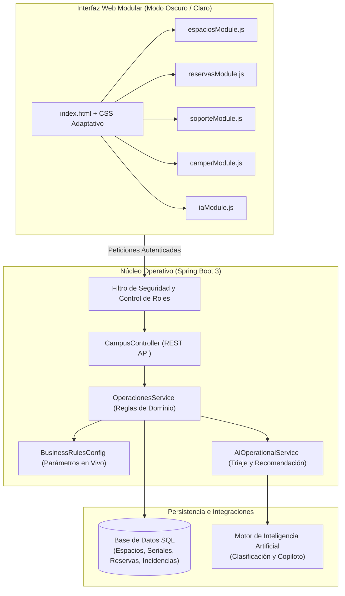

<div align="center">


# Campusland Ops
### Sistema Central de Gestión Operativa e Inteligencia de Espacios


<p align="center">
  Plataforma integral para la administración en tiempo real de salones de entrenamiento, salas de estudio, trazabilidad de inventario por serial, préstamos individuales y atención automatizada de incidentes.
</p>

</div>

---

## Equipo de Desarrollo

| Integrante | Rol Principal y Responsabilidades |
| :--- | :--- |
| **Heiling Gisselle León Bernal** | Arquitectura Backend, Motor de Reglas de Negocio e Integración de Inteligencia Artificial |
| **Sebastián Feo Murillo** | Diseño de Interfaz (Modo Oscuro / Claro), Arquitectura Modular Frontend y Experiencia de Usuario |
| **Pedro Díaz** | Modelado de Base de Datos, Carga del Catálogo Oficial de Espacios y Trazabilidad de Seriales |
| **Julián Agudelo** | Seguridad, Autenticación por Roles, Control de Sesiones y Validación de Bloques Horarios |
| **Juan Arias Patiño** | Aseguramiento de Calidad (QA), Validación de Casos Borde, Documentación y Defensa Técnica |

---

## Propósito del Sistema

El crecimiento acelerado del campus requiere centralizar procesos que antes dependían de revisiones manuales o registros dispersos. **Campusland Ops** unifica en un solo centro de operaciones tres pilares críticos:

1. **Disponibilidad y Asignación de Espacios:** Control de aforo físico máximo, validación de cruces horarios y eficiencia de ocupación en aulas de entrenamiento, auditorio y salas de estudio.
2. **Trazabilidad de Inventario y Préstamos:** Monitoreo individualizado por serial de estaciones de trabajo (Monitor, Mouse, Torre y Teclado), televisores con cable HDMI y préstamos individuales para estudiantes.
3. **Gestión y Triaje Inteligente de Incidentes:** Clasificación automática de reportes de daños, bloqueo preventivo inmediato de espacios ante fallas críticas y reubicación asistida de grupos activos.

---

## Arquitectura del Sistema



---

## Módulos y Permisos por Rol

| Rol | Credencial de Acceso | Contraseña | Capacidades dentro de la Plataforma |
| :--- | :--- | :--- | :--- |
| **ADMIN** | `admin@campuslands.com` | `admin123` | Tablero global de métricas, aprobación o rechazo de solicitudes de Trainers y Campers, bandeja de reportes de daños, bloqueo/habilitación de salones y CRUD completo de espacios. |
| **TRAINER** | `trainer@campuslands.com` | `trainer123` | Solicitud de salones por bloque horario, recomendador inteligente de salón óptimo, reporte de fallas en clase con reubicación automática y consulta de sus propias reservas. |
| **SOPORTE** | `soporte@campuslands.com` | `soporte123` | Bandeja de incidentes priorizada por nivel de urgencia (`CRITICA`, `MEDIA`, `BAJA`), resolución de tickets con rehabilitación automática de salones e inventario técnico por serial. |
| **CAMPER** | `camper@campuslands.com` | `camper123` | Solicitud de salas de estudio de hasta 12 personas, préstamo individual de equipos tecnológicos (máximo 1 activo), devolución en línea y reporte de incidentes. |

---

## Reglas de Negocio Implementadas

Todas las validaciones operan tanto en la interfaz como en la capa de dominio del servidor:

1. **Límite Estricto de Aforo Físico:** Ningún rol (incluido el Administrador) puede registrar una reserva cuya cantidad de asistentes supere la capacidad física instalada del salón seleccionado.
2. **Flujo de Aprobación Centralizado y Privacidad:** Toda solicitud creada por un `TRAINER` o `CAMPER` ingresa en estado `PENDIENTE` para revisión del Administrador. Cada usuario visualiza únicamente sus propios registros, mientras que el Administrador supervisa la totalidad del campus.
3. **Regla Anti-Subutilización del 50% (con Excepción Inteligente):** Un `TRAINER` debe ocupar al menos el 50% de la capacidad del aula solicitada. Si solicita un salón grande para un grupo pequeño, el sistema verifica si existe un salón menor disponible en ese horario y lo sugiere; si todos los salones menores están ocupados o bloqueados, autoriza la excepción automáticamente.
4. **Prevención de Cruces de Horario:** El sistema bloquea cualquier intento de solapamiento en el rango `[horaInicio, horaFin)` para una misma fecha y salón.
5. **Bloqueo Preventivo y Rehabilitación Automática:** Cuando se reporta un incidente clasificado como prioridad `CRITICA` (riesgo eléctrico, humo, caída total), el salón pasa inmediatamente a estado `BLOQUEADO` e impide nuevas reservas. Cuando Soporte o Administración marca el incidente como `RESUELTA`, el salón vuelve automáticamente a `DISPONIBLE`.
6. **Control de Préstamos Individuales para Campers:** Un `CAMPER` solo puede tener **1 equipo tecnológico activo** a la vez y no puede solicitar préstamos por lotes. Hasta que no registre la devolución del equipo actual, el sistema bloquea nuevas solicitudes.

---

## Integración Estratégica de Inteligencia Artificial

La plataforma integra asistencia inteligente conectada al estado real del campus en tres flujos operativos:

* **Triaje Automatizado de Incidentes:** Analiza reportes en lenguaje natural, determina la categoría técnica (`Infraestructura / Eléctrico`, `Equipos de Cómputo`, `Audio y Video (TV / HDMI)` o `Mobiliario`), asigna la prioridad (`CRITICA`, `MEDIA`, `BAJA`), genera una recomendación de intervención y activa el bloqueo preventivo si detecta riesgo crítico.
* **Recomendación y Reubicación de Aulas:** Evalúa los salones habilitados y libres en la franja horaria solicitada para asignar el espacio que mejor cumpla la relación de aforo y equipamiento, permitiendo reubicar clases activas en un clic cuando ocurre una falla técnica.
* **Asistente de Consultas Operativas:** Responde preguntas en tiempo real sobre disponibilidad de salones, capacidad instalada e implementos recomendados según el tamaño del grupo.

---

## Catálogo Oficial Cargado al Inicio

El inicializador de datos configura automáticamente los **10 espacios oficiales** y su inventario detallado:

| Espacio | Categoría | Capacidad | Inventario Asociado |
| :--- | :--- | :---: | :--- |
| **Auditorio** | Auditorio | 100 personas | 2 Televisores con sus respectivos Cables HDMI |
| **Spooki** | Aula de Entrenamiento | 38 personas | 35 Computadores completos por serial (Monitor, Mouse, Torre y Teclado) |
| **Apolo** | Aula de Entrenamiento | 34 personas | 34 Computadores completos por serial (Monitor, Mouse, Torre y Teclado) |
| **Artemis** | Aula de Entrenamiento | 34 personas | 32 Computadores completos por serial (Monitor, Mouse, Torre y Teclado) |
| **Cosmos** | Aula de Entrenamiento | 22 personas | 1 Televisor con su Cable HDMI |
| **Skilab** | Laboratorio | 21 personas | 1 Televisor con su Cable HDMI |
| **Sala Blanca** | Sala de Estudio | 12 personas | 1 Televisor con su Cable HDMI |
| **Sala Azul** | Sala de Estudio | 10 personas | 1 Televisor con su Cable HDMI |
| **Sala Amarilla** | Sala de Estudio | 6 personas | 1 Televisor con su Cable HDMI |
| **Sala Verde** | Sala de Estudio | 6 personas | 1 Televisor con su Cable HDMI |

---

## Punto de Modificación Rápida para Sustentación

Para ajustar parámetros de negocio en vivo en menos de 1 minuto durante la sustentación, todas las constantes críticas están centralizadas en:

`src/main/java/com/campuslands/ops/config/BusinessRulesConfig.java`

```java
public final class BusinessRulesConfig {
    // 1. Porcentaje mínimo de ocupación exigido al Trainer (0.50 = 50%)
    public static final double PORCENTAJE_MINIMO_OCUPACION_TRAINER = 0.50;

    // 2. Capacidad máxima de las salas que puede solicitar un Camper (12 personas)
    public static final int CAPACIDAD_MAXIMA_SALAS_CAMPER = 12;

    // 3. Cantidad máxima de préstamos activos simultáneos por Camper (1 unidad)
    public static final int MAX_PRESTAMOS_ACTIVOS_CAMPER = 1;
}
```

---

## Guía de Instalación y Ejecución

### 1. Requisitos Previos
* **Java JDK 17** o superior.
* **Maven 3.9+** (o ejecución directa desde IntelliJ IDEA).
* **MySQL 8+** en `localhost:3306` *(opcional: si el servicio MySQL no está activo en el equipo de evaluación, el sistema activa automáticamente su base de datos persistente local en `./data/` sin requerir configuración adicional)*.

### 2. Configuración de Variables de Entorno
Crea un archivo `.env` en la raíz del proyecto basándote en la plantilla `.env.example` (el archivo `.env` está excluido en `.gitignore` para proteger las credenciales):

```ini
DB_URL=jdbc:mysql://localhost:3306/campuslands_ops?createDatabaseIfNotExist=true&useSSL=false&allowPublicKeyRetrieval=true&serverTimezone=UTC
DB_USERNAME=root
DB_PASSWORD=tu_password_local
AI_API_KEY=tu_clave_de_api
JWT_SECRET=clave_secreta_para_firma_de_sesiones_2026
```

### 3. Ejecución del Servidor
```powershell
mvn spring-boot:run
```
Una vez iniciado el servidor, abre en el navegador:
```text
http://localhost:8080
```
